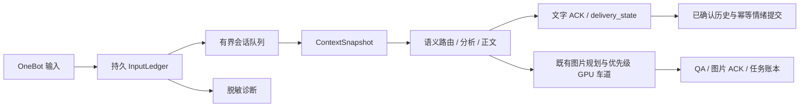

# 晚风 VNext：稳定性正式迭代（2026-11-14）

## 发布范围

本版本以本机已整合 SnowLuma、双调用、提示词检定的实际 Python 源码为基准，修复运行可靠性。它不是交接计划 G0–G7 全部完成的声明。既有角色、人设、关系、四类图片、QA、GPU 空闲卸载及图片恢复逻辑继续保留。

## 修改说明

| 领域 | 本次变化 | 数据所有者及失败退路 |
|---|---|---|
| 消息入口 | 后台任务数不再阻断入站；畸形 segment 与单消息异常隔离；每会话 100、全局 1000 条排队上限 | InputLedger 先登记，超限明确 rejected；取消指令绕过普通限额 |
| 持久入账 | 新增 inputs.db；按会话与消息 ID 去重，记录原文与状态；后台诊断只显示匿名 ID、状态、原因 | 重启将排队/执行中的消息标成 outcome_unknown，不自动重发或重画 |
| 上下文 | ContextSnapshot 冻结会话版本、场景版本、历史、背景、状态、讨论资料；分析和正文消费同源数据 | 返回切片是独立副本；背景读取最多等 8 秒，网络/读取失败按不可用背景降级 |
| 双调用 | 历史指代、情绪关系追问可触发分析；重复笑声和控制指令不因长度触发 | 长度只作兜底，保留 CHAT_SPLIT_MIN_CHARS；分析失败回到完整 text 契约 |
| 记忆 | 所有事实类型都要求 value 是 evidence 的连续片段；拒绝真实引文搭配虚构值 | 保守提取可能漏掉合理改写，但不把模型改写直接当作事实 |
| 情绪 | 空增量查询不再写库；已确认回复的情绪提交带 input_id 去重 | feelings 仍是原表，增加 committed_affect 表；长期关系体系不变 |
| 文字回执 | 缺少 message_id 不提交已说历史；同一回执不重复提交 | UNKNOWN 保留待核对，不再额外发“这次没完成”提示 |
| GPU 排队 | 复用原优先级车道，等待者最多 64，等待最长 120 秒 | 超时/取消移除等待者，释放自己的资源，不抢占活动 GPU |
| 服务管理 | SnowLuma 成为唯一自动管理的 QQ 接入路线 | 断线不启动 NapCat，不杀 QQ 或 ComfyUI；旧工具函数保留兼容资料用途 |
| 诊断 | 日志页新增输入任务诊断，接口 /api/inputs | 继承本机 bearer 校验；只读数据库，不返回原话、QQ 账号或密钥 |

## 验证

- 改造前：372 项测试，3 项失败，均来自旧测试依赖私人课表。现改为显式合成课表，不修改用户课表。
- 改造后全量：`python -m unittest discover -q`，379 项通过，85.391 秒。
- 测试覆盖现有假 OneBot/ComfyUI 链路、取消、QA 拒绝、ACK 不明、图像恢复、提示词校验、并发状态合并，并新增输入密集接收、队列拒绝、重启去重、快照隔离、虚构记忆拒绝、情绪纯读、GPU 排队超时/容量、重复回执测试。
- 真实 DeepSeek：3 个合成输入，2 个双调用、1 个单调用，3 个有效正文，约 2.87/2.88/1.04 秒。此前一次分析返回多余 JSON 尾部而解析失败，已确认必须走完整文字契约降级。这个小样本不能代表长期语义质量。
- 没有真实 QQ 测试投递，没有真实 GPU 生成。模拟图片成功只证明代码链路，不证明画面质量或真实硬件稳定性。

## 数据与回滚

本机运行配置、SQLite 一致性副本及源码已先行备份。旧数据库不做删表或重写；新表只在启动后按需创建。回滚时停止机器人和管理器，恢复本批修改的源码与网页，再启动；保留新增 inputs.db 与 committed_affect 表不会妨碍旧代码。除非确需还原时间点，不恢复旧数据库，以免覆盖发布后新对话。工作流文件逐个 SHA-256 对照，部署不覆盖任何工作流、角色卡、偏好、课表、launcher.json 或 .env。

## 与完整蓝图的差距（不得视为已验收）

- 本次快照冻结的是已组装的模型输入；尚未把全部领域拆成独立版本向量和独立 FactStore。
- 原有图片调度与状态提交被加强，但尚未全面替换为统一 TaskCoordinator / StateCommitter 类；不引入第二套写入者。
- 入站过载会持久记录 rejected，尚未实现自动恢复持久队列；重启中断为 UNKNOWN，需要人工核对，避免重发。
- 未新增 G6 的主动文字、动态关系评分和扩展表情库；仍使用现有能力。
- 未做长期真机陪聊、断网恢复和卸载后真实绘图验收；工作流保持不变。正式发布代表上述明确范围的源码迭代，不代表整份远期架构蓝图已经落地。
